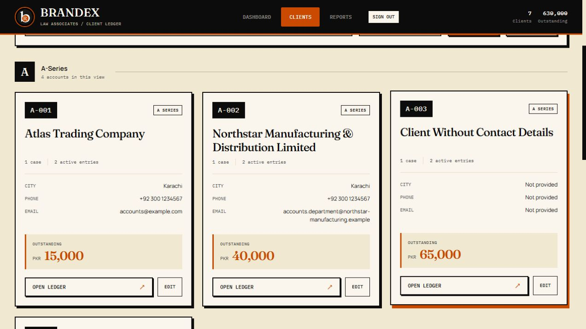
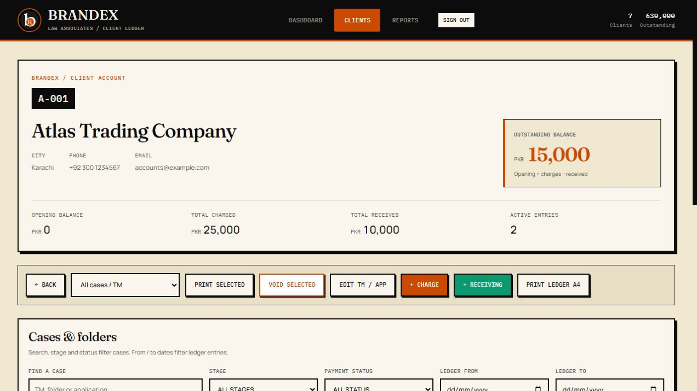

# Brandex editorial screen design

This screen design follows the approved cream, black and orange Brandex identity. The user requested distinctive typography across the whole application.

## Visual system

| Role | Treatment |
| --- | --- |
| Page headings, client names, headline amounts | Fraunces serif, medium weight |
| Body text, contact data and form inputs | Manrope sans-serif |
| Account codes, labels, navigation, dates and table amounts | IBM Plex Mono |
| Primary actions and outstanding balances | Brandex orange |
| Receivings and credit balances | Existing Brandex green |
| Cards and panels | Cream surfaces, square borders and hard shadows |
| Ledger/report rows | Compact 12px text, 9px vertical padding, right-aligned amounts |

New styles apply to screen media. Existing print fonts, rules and templates remain separate.

## Information and actions

- Client cards: code, series, name, case count, active-entry count, contact details, balance status and separate Open ledger/Edit controls. Missing contacts read Not provided. Counts reflect the displayed client; voided entries are excluded from active counts.
- Account balance: opening balance + active charges - active receivings. Positive means Outstanding; negative means Credit balance; zero means Settled balance. The signed amount is preserved.
- Dashboard outstanding: active charges minus active receivings, preserving its existing calculation. Opening balances are shown in each client account summary.
- Client profile: identity/contact details, opening balance, total charged, total received, active entries and net account balance.
- Case filters: search, stage and payment status filter cases. Case selection and from/to dates narrow ledger entries. Stage balance cards retain their existing case scope and include all dates; opening balance is separate.
- Reports: blank filters include matching entries across that field. Select group checks its entry rows. Print A4 prints selected rows; when nothing is selected it prints the current report.
- Void Selected is a soft-void action, preserving the existing confirmation and database behavior.
- Dialogs: linked labels, notes, focus containment, Escape close and focus restoration. Staff sign-in preserves credential casing and keeps background controls inert until the existing auth gate is hidden.

## Validation and limits

Inspected the real application with synthetic local data, with every fixture write disabled, at desktop 1280px, tablet 768px and phone 390px. Tested search/series filters, missing and long contact details, credit/settled/opening balances, client navigation, all ledger dialogs, bank-date visibility, modal keyboard behavior, report selection and A4 content preparation. Changed JavaScript passes syntax checks; static IDs, field labels, script references and unchanged inline print CSS were checked.

Authenticated production records and database writes were not tested. A4 content preparation was observed, but print-media inspection blocked in the automated browser; physical/PDF output remains unverified. Screenshots below contain synthetic data.

